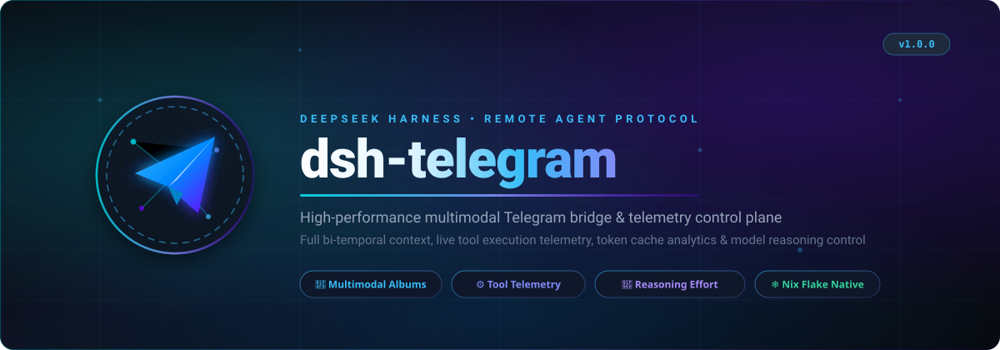

<p align="center">
  
</p>

<p align="center">
  <a href="https://github.com/surtr85/dsh-telegram/releases"></a>
  <a href="LICENSE"></a>
  <a href="https://nodejs.org"></a>
  <a href="https://nixos.org"></a>
  <a href="https://grammy.dev"></a>
</p>

---

**`dsh-telegram`** is a high-performance, multimodal Telegram gateway and remote control plane for [DeepSeek Harness (DSH)](https://github.com/deepseek-ai) AI coding agents.

It allows you to supervise, guide, inspect, and prompt your local DeepSeek Harness agent sessions directly from your phone or desktop via Telegram with low latency, full telemetry, and bidirectional multimodal image & file streaming.

---

## ⚡ Key Highlights

- 📸 **Bidirectional Multimodal Engine**:
  - **Inbound**: 1-second debounced album grouping (`media_group_id`) bundles photos and images into a single native `PromptContentPart[]` turn.
  - **Outbound**: Automatically detects assistant Markdown images, loads local/remote files, and delivers them as high-resolution native Telegram Photo posts or Media Group albums with HTML captions.
- 📄 **Code & Text Document Ingestion**:
  - Drag-and-drop code files (`.py`, `.ts`, `.json`, `.yaml`, `.log`, `.txt`, `.md`, `.nix`, `.sh`).
  - Binary sniffing protection with truncation safety limits (up to 100K characters) injected directly into agent context.
- 📊 **Deep Context & Token Telemetry (`/stats`)**:
  - Real-time dashboard powered directly by native DSH Projections (`@deepseek-ai/dsh-session-stats`, `contextPressure`, `contextBreakdown`).
  - Reports context window usage percentage, system prompt tokens, tool definition tokens, decode speed (tokens/sec), average time to first token (TTFT), and cache hit ratios.
- 🧠 **Dynamic Model & Reasoning Selector (`/model`)**:
  - Interactive Inline Keyboard querying `session/modelCatalog`.
  - 1-click model switching and dynamic reasoning effort adjustment (`Off`, `Low`, `Medium`, `High`, `Max`).
- 🧹 **Context Compaction (`/compact`)**:
  - Triggers native `@deepseek-ai/dsh-command-compact` RPC directly from Telegram to summarize history and reclaim context tokens.
- 🛑 **Turn Cancellation (`/stop` / `/cancel`)**:
  - Instant agent turn abort using DSH RPC `session/cancel`.
- 🛡️ **Zero Cloud Dependencies & Enterprise Security**:
  - Authenticates against local DSH port via HMAC-SHA256 cookie signing.
  - Strict user whitelisting drops unauthorized messages immediately.
- ❄️ **Nix Flake Native**:
  - Packaged with reproducible `flake.nix` for instant execution and declarative NixOS / Home Manager deployment.

---

## 🎮 Command Reference

| Command | Description |
| :--- | :--- |
| `/start` | Overview, connection status, and quick capabilities guide. |
| `/new` | Spawn a fresh, isolated DSH agent session. |
| `/stats` | Comprehensive telemetry dashboard: Context Window %, Token Breakdown, TTFT, Speed & Cache Hit Ratio. *(Aliases: `/session`, `/status`)* |
| `/sessions` | Interactive menu listing recent sessions with 1-tap switching. |
| `/attach` | Hot-attach to the newest active session opened in the DSH Web GUI. |
| `/model` | AI Model switcher with dedicated reasoning effort selection buttons. |
| `/compact` | Trigger history compaction to compress context tokens into a summary. |
| `/rename <title>` | Rename the title of the active session. |
| `/stop` / `/cancel` | Immediately cancel and interrupt the active agent turn or running tool. |

---

## 🏗 Architecture

```
                      ┌────────────────────────────────────────┐
                      │            Telegram Client             │
                      │       (Mobile / Desktop / Web)         │
                      └──────────────────┬─────────────────────┘
                                         │ Telegram Bot API (grammY)
                                         ▼
┌──────────────────────────────────────────────────────────────────────────────┐
│                            dsh-telegram Daemon                               │
│                                                                              │
│  ┌───────────────────────┐   ┌───────────────────┐   ┌───────────────────┐   │
│  │ Media Group Debouncer │   │ Strict HTML Sanitizer│   │ FIFO Turn Queue   │   │
│  └───────────────────────┘   └───────────────────┘   └───────────────────┘   │
│                                                                              │
│  ┌────────────────────────────────────────────────────────────────────────┐  │
│  │                            DshClient                                   │  │
│  │   • HMAC-SHA256 Cookie Auth    • WebSocket Mux (`/api/remote.mux`)    │  │
│  │   • Typed Typert RPCs          • Live Assistant Stream Reader         │  │
│  └────────────────────────────────────────────────────────────────────────┘  │
└────────────────────────────────────────┬─────────────────────────────────────┘
                                         │ HTTP RPC / WebSocket (127.0.0.1:3080)
                                         ▼
                      ┌────────────────────────────────────────┐
                      │          DeepSeek Harness (DSH)        │
                      │        Autonomous AI Coding Core       │
                      └────────────────────────────────────────┘
```

---

## 🚀 Getting Started

### Prerequisites

- Node.js >= 22.0.0 and `pnpm` (or Nix)
- A running DeepSeek Harness instance (default: `http://127.0.0.1:3080`)
- A Telegram Bot Token from [@BotFather](https://t.me/BotFather)
- Your Telegram User ID (obtain from [@userinfobot](https://t.me/userinfobot))

### Quick Setup

1. **Clone the repository:**
   ```bash
   git clone https://github.com/surtr85/dsh-telegram.git
   cd dsh-telegram
   ```

2. **Install dependencies and build:**
   ```bash
   pnpm install
   pnpm build
   ```

3. **Configure environment:**
   Create a `config.json` in `~/.dsh/telegram.json` or pass environment variables:
   ```json
   {
     "telegramToken": "YOUR_BOT_TOKEN_HERE",
     "allowedUserId": 7273048535,
     "dshAuthority": "127.0.0.1:3080",
     "defaultCwd": "/home/amadeus/Projects"
   }
   ```
   *Alternatively, configure via `.env`:*
   ```env
   TELEGRAM_BOT_TOKEN=YOUR_BOT_TOKEN_HERE
   TELEGRAM_ALLOWED_USER_ID=7273048535
   DSH_AUTHORITY=127.0.0.1:3080
   DEFAULT_CWD=/home/amadeus/Projects
   ```

4. **Run the gateway:**
   ```bash
   pnpm start
   ```

---

## ❄️ Nix & NixOS Flake Integration

### Run Directly via Flake

```bash
nix run github:surtr85/dsh-telegram
```

### Declarative Home Manager Service

In your Home Manager configuration:

```nix
systemd.user.services.dsh-telegram = {
  Unit = {
    Description = "DeepSeek Harness Telegram Bridge";
    After = [ "network.target" "dsh-web.service" ];
    Wants = [ "dsh-web.service" ];
  };

  Service = {
    Type = "simple";
    ExecStart = "${pkgs.dsh-telegram}/bin/dsh-telegram";
    Restart = "always";
    RestartSec = 5;
    StandardOutput = "journal";
    StandardError = "journal";
  };

  Install = {
    WantedBy = [ "default.target" ];
  };
};
```

---

## 📄 License

MIT © [Sajjad (surtr85)](https://github.com/surtr85)
